<!--
  The graphics in assets/ are generated by assets/build.py (fonts: Space Grotesk,
  Inter, JetBrains Mono). Edit the text there and run: python assets/build.py
  The activity card is rebuilt daily by .github/workflows/profile-cards.yml (assets/activity.py).
  Each graphic has a -dark and -light version that follows the viewer's GitHub theme.
-->

<a href="https://github.com/ayushkzz"><picture><source media="(prefers-color-scheme: dark)" srcset="./assets/hero-dark.svg" /></picture></a>

  

<picture>
  <source media="(prefers-color-scheme: dark)" srcset="./assets/h-about-dark.svg" />
  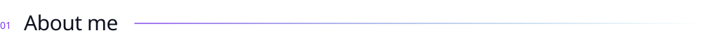
</picture>

<picture>
  <source media="(prefers-color-scheme: dark)" srcset="./assets/about-dark.svg" />
  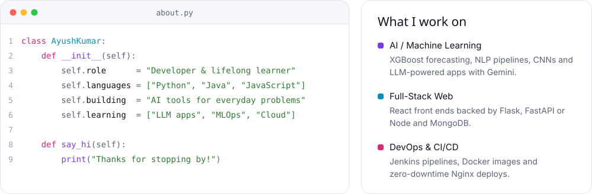
</picture>

  

<picture>
  <source media="(prefers-color-scheme: dark)" srcset="./assets/h-toolbox-dark.svg" />
  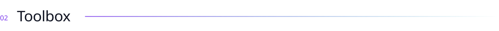
</picture>

<picture>
  <source media="(prefers-color-scheme: dark)" srcset="./assets/toolbox-dark.svg" />
  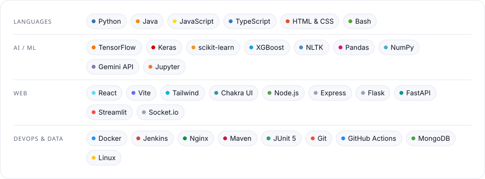
</picture>

  

<picture>
  <source media="(prefers-color-scheme: dark)" srcset="./assets/h-work-dark.svg" />
  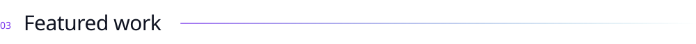
</picture>

  <a href="https://github.com/ayushkzz/Adaptive-AQI-Assistant"><picture><source media="(prefers-color-scheme: dark)" srcset="./assets/project-aqi-dark.svg" />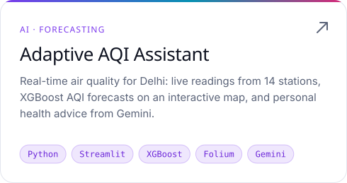</picture></a>
  <a href="https://github.com/ayushkzz/Pair-Programming"><picture><source media="(prefers-color-scheme: dark)" srcset="./assets/project-pair-dark.svg" />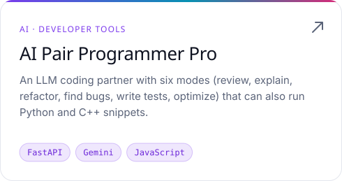</picture></a>
  <a href="https://github.com/ayushkzz/ai-powered-education-feedback"><picture><source media="(prefers-color-scheme: dark)" srcset="./assets/project-edu-dark.svg" />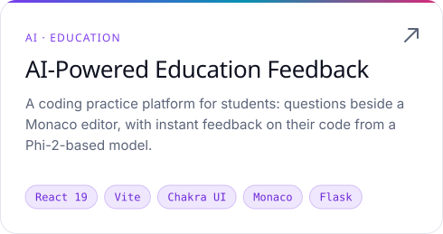</picture></a>
  <a href="https://github.com/ayushkzz/blue-green-project"><picture><source media="(prefers-color-scheme: dark)" srcset="./assets/project-bluegreen-dark.svg" />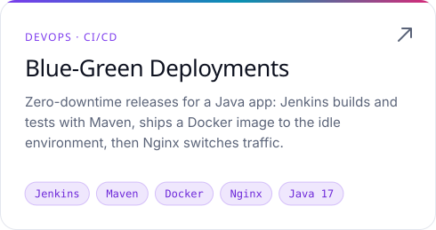</picture></a>
  <a href="https://github.com/ayushkzz/Alumni-Student-platform"><picture><source media="(prefers-color-scheme: dark)" srcset="./assets/project-alumni-dark.svg" />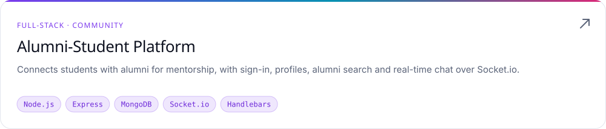</picture></a>

 

<picture>
  <source media="(prefers-color-scheme: dark)" srcset="./assets/h-activity-dark.svg" />
  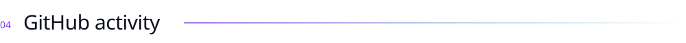
</picture>

<picture>
  <source media="(prefers-color-scheme: dark)" srcset="./assets/activity-dark.svg" />
  
</picture>

 

<a href="https://github.com/ayushkzz"><picture><source media="(prefers-color-scheme: dark)" srcset="./assets/outro-dark.svg" /></picture></a>

<!-- Add your other profiles here when you're ready, for example:

  

-->
